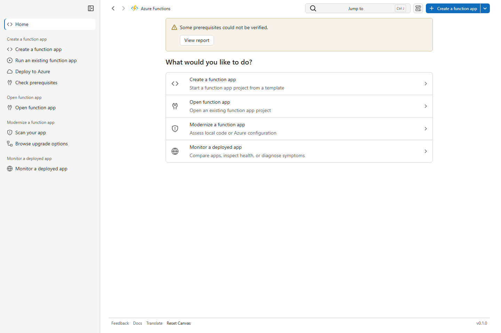
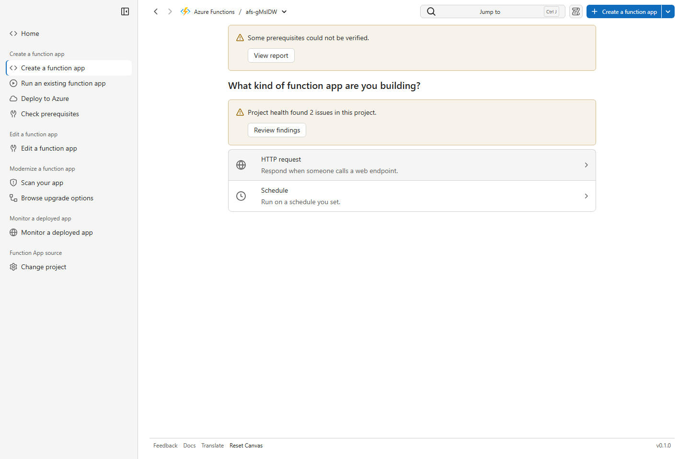
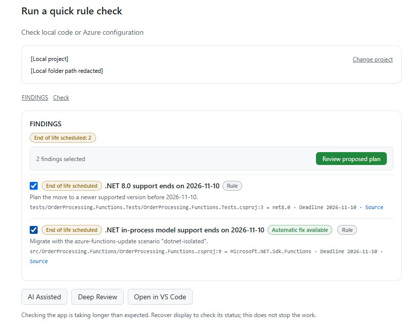
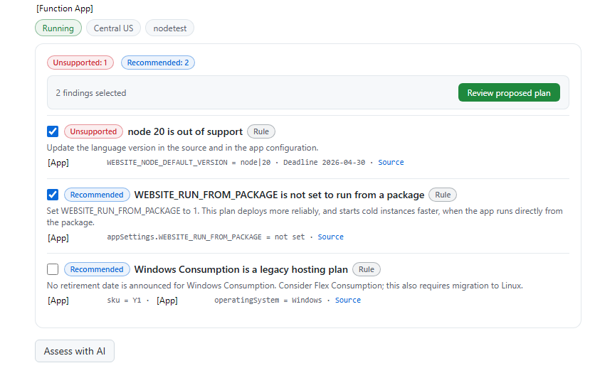

# Azure Functions

Build a Function App, modernize an existing app, and find code or configuration
issues before they become production problems. Use templates and guided
controls on their own, or ask AI to help customize, review, and plan changes.

## Install

In the GitHub Copilot app, open **Customize → Plugins** and install
**Azure Functions** when your marketplace lists it. Reopen Copilot and start
a fresh chat.

**Azure Functions Hosted Skills** is a separate plugin, not an installation
of this one. See the [prerequisites](docs/advanced.md#prerequisites) for the
tools needed for each task.

## Try it

Ask **Open Azure Functions canvas**, then choose a task on Home.
One canvas brings creation, editing, modernization, and monitoring together:

- **Create a function app:** choose a starter and destination for a local
  function app project. Describe your app
  for AI customization, or open **Creation options → Create from starter**
  to create it without AI. Run locally and review deployment settings when ready.
- **Open function app:** select a local project or GitHub source, then add functions from official templates,
  edit the source preview, and review before applying. Or describe changes with
  **Customize with AI** and review proposed edits in chat.
- **Modernize a function app:** select a local project or an Azure app and
  run a rule check. Review the findings before asking for a fix plan.

For a closer look at local code and configuration, open **Deep Review** from
**Jump to** and confirm that you trust the project.

## What you can do

- **Get started faster.** Create from official Azure Functions templates,
  including AI agent starters, with or without AI customization. Open the
  project in VS Code, run it locally, and deploy with Azure Developer CLI (`azd`).
- **See what needs modernizing.** Find end-of-life or unsupported runtimes,
  programming models, and hosting plans. Select findings and review a migration
  or fix plan before approving changes.
- **Find code and configuration issues earlier.** Use read-only **Deep Review**
  to inspect a trusted local project against Azure Functions best practices.
  Review findings in the canvas before deciding what to change.

Checks do not change your app. Fixes require separate approval; deployment
is a separate action that can create billable Azure resources.

See creation and review screens

**Choose a function starter**

**Review a local project**

**Review a deployed app**

Home and creation views use synthetic fixtures. App names and local folder
paths are redacted in the review screenshots.

## Prompts to try

> Open Azure Functions canvas so I can create a Python HTTP function app project without AI customization.

> Open Azure Functions canvas so I can check this project's runtime and programming model.

> Open Azure Functions canvas so I can run Deep Review on this local project.

## Usage data

Usage telemetry is enabled by default to help improve this plugin. It sends
basic canvas and skill usage data and, when available, your numeric GitHub
user ID to the
[usage metrics service](https://canvas-metrics-pilot-0b8944-add3hsghhddcbxe9.b01.azurefd.net/api/events).
Prompts, tool inputs/outputs and credentials are excluded.

You can [disable usage telemetry](https://github.com/microsoft/azure-dev-tools#disable-usage-telemetry).
Copilot's own telemetry is separate.

## Learn more

See the [detailed usage guide](docs/advanced.md), the
[check catalog](docs/checks.md), and [lifecycle data](docs/lifecycle-data.md).
