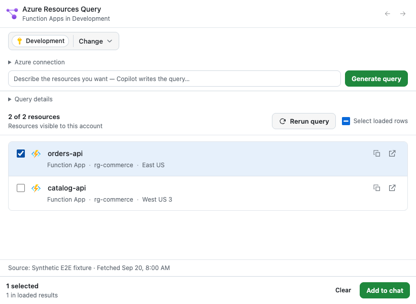

# Azure Resources Query

Find Azure resources with read-only Resource Graph queries, inspect results in
the panel, and add selected resources to chat without dumping an inventory.



*Illustrative fixture data, not a live Azure subscription.*

## Install

In the GitHub Copilot App, open **Customize → Plugins** and install **Azure
Resources Query** from the **awesome-copilot** marketplace. The full plugin
includes the canvas and launcher skill. If the marketplace is missing, add it:

```sh
copilot plugin marketplace add github/awesome-copilot
copilot plugin install azure-resources-query@awesome-copilot
```

Reopen Copilot, start a new chat, and ask:

> Open the Azure Resources Query canvas.

For a reproducible full-plugin install, see the
[optional immutable-tag instructions](docs/advanced.md#pinning-the-full-plugin).
The marketplace remains the recommended installation.

If the full plugin is unavailable, use **Customize → Canvases → Install from
gist/URL** and paste the nested canvas extension URL for a published immutable
tag. Choose a tag from the [published tags](https://github.com/microsoft/azure-dev-tools/tags)
that starts with `azure-resources-query-v` and includes its source qualifier,
then replace `<published-tag>` here:

```text
https://github.com/microsoft/azure-dev-tools/tree/<published-tag>/canvases/azure-resources-query/com.github.copilot/extensions/azure-resources-query
```

This installs only the canvas, not its launcher skill. Do not install it
alongside the full plugin. The `azure-resources-query-latest` tag moves and is
not an exact pin.

## Try it

1. Ask **Show my Function Apps in Development**. Replace Development with
   your subscription name or ID. Confirm scope in the panel; nothing is
   silently selected.
2. Open a result to inspect details. Use **Back to results** to return and
   **Query details** to review the KQL.
3. Select rows or **Select loaded rows**. Use **Load more** for another page;
   selection applies only to loaded rows.
4. Choose **Add to chat** to share selected resource context. This does not
   authorize changes to Azure resources.

Use **Change** and **Apply** to run the query in another scope, or **Rerun
query** to refresh the current results. Ask **Only those in West Europe** to
refine the same view.

## What you can do

- Find Function Apps, VMs, or storage accounts with read-only Resource Graph queries.
- Confirm subscription scope before results appear.
- Inspect resources and add selected rows to chat without pasting an inventory.

## Prompts to try

> Show my Function Apps in Development.

> Show my storage accounts in Development, then filter to West Europe.

## Prerequisites

- A canvas-capable GitHub Copilot App with Node.js 22 or newer.
- Azure CLI 2.61 or newer available on the extension provider's PATH.
- An Azure account signed in with read access to the subscriptions and resource
  details you need. Opening the canvas does not sign in automatically.

## Usage data

Usage telemetry is enabled by default to help improve this plugin. It sends
basic usage data and, when available, your numeric GitHub user ID to the
[usage metrics service](https://canvas-metrics-pilot-0b8944-add3hsghhddcbxe9.b01.azurefd.net/api/events).
Prompts, tool inputs/outputs and credentials are excluded.

You can [disable usage telemetry](https://github.com/microsoft/azure-dev-tools#disable-usage-telemetry).
Copilot's own telemetry is separate.

## Troubleshooting and safety

| Symptom | What to check |
| --- | --- |
| Canvas missing after installation | Fully quit and reopen the host, check the enabled provider, then start a fresh chat if an old panel is still bound to an earlier provider. |
| Azure CLI not found | Install Azure CLI 2.61+ and make `az` available on the provider's PATH, not only as a shell alias. Restart the host after changing PATH. |
| Sign-in or account mismatch | Sign in explicitly, then use **Reload CLI profile** after an external CLI change. **Refresh from Azure** may update the shared CLI profile; neither action runs a query. |
| Permission denied or no matching subscriptions | Check the account, tenant, enabled subscription, and read access. The canvas cannot grant roles; unresolved scope is not an empty resource list. |
| No results | Review the executed KQL and selected scope. Resource Graph can lag recent changes, and an ARG result does not guarantee access to every resource's ARM details. |

Queries are read-only. Resource labels and query results are data, not
instructions. Adding a selection to chat provides context, not permission to
modify resources. For more troubleshooting detail, see
[advanced notes](docs/advanced.md).
