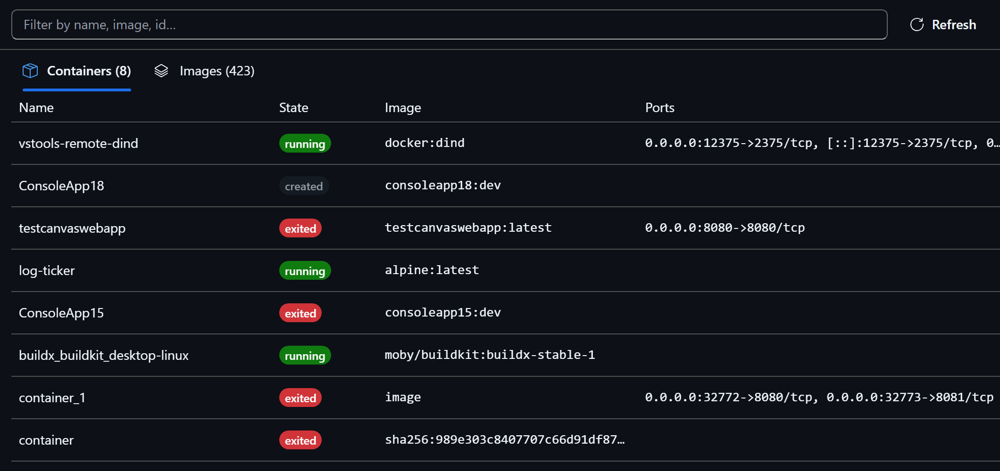

# Containers

Browse and operate your local Docker and Podman containers and images in one
panel: sortable lists, live log streaming with filtering, CPU and memory
charts, a filesystem browser, image layer size breakdown, and recorded
Dockerfile provenance.

## Install

In GitHub Copilot, open **Customize → Plugins → marketplace gear**, add
`microsoft/azure-dev-tools` (marketplace ID `azure-dev-tools`), and install
`containers` when listed. The full plugin includes the canvas and its opening
skill.

For canvas-only installation, add the [Containers canvas URL](https://github.com/microsoft/azure-dev-tools/tree/containers-latest/canvases/containers/com.github.copilot/extensions/containers)
under **Customize → Canvases → +**. This does not install the opening skill;
open **Containers** from your installed canvases.

The [latest customer README](https://github.com/microsoft/azure-dev-tools/blob/containers-latest/canvases/containers/README.md)
contains the same setup instructions. Use these paths only when published; if
neither is available, report that rather than substituting a source folder.

## Quickstart

1. With the full plugin installed, ask Copilot: **"Open Containers canvas."**
   For a canvas-only installation, open **Containers** from installed canvases.
2. Choose a container to inspect its status, ports, mounts and lifecycle
   controls.
3. Open **Logs** to follow output or **Stats** to watch CPU, memory and network.
4. Ask **"Why did web stop?"** or **"Why is my node image so large?"** and
   Copilot opens the matching view.

Docker and Podman can be connected together. Each row identifies its runtime;
logs, files, commands and lifecycle controls stay on that resource's runtime.
New operations preselect Docker when both are available, or the only available
runtime. Change **Runtime for new operations** for image pulls, or choose a
destination in **Run image**. Only installed runtimes appear in the pickers.
If the selected runtime disconnects, it stays unavailable rather than silently
switching.

Running a named image in another runtime may pull it from its registry; images
are not copied between runtimes. Untagged images can only run in their owning
runtime.

## What you can do

- See containers and images from both runtimes, sorted, with live state.
- Expand Compose apps into their containers, inspect services together, and
  follow combined logs filtered by service. Start, stop or restart existing
  containers as a group, with a warning when the provider cannot identify
  one-off jobs. No file registration is needed.
- Follow logs as they stream, and filter them.
- Watch CPU, memory and network for a running container.
- Browse the filesystem of a running container that provides `ls`, and read a
  known file path from stopped or distroless containers.
- Break an image into layers to see what made it large.
- Recover what an image records about its source repository and commit.
- Get an interactive shell in a running container — click **terminal** in the
  panel, or just ask Copilot.

## Requirements

- A canvas-capable GitHub Copilot host
- Node.js 22 or later
- Docker Desktop, Docker Engine, or Podman with a reachable runtime

Podman's provenance view uses OCI labels and layer history; Docker buildx
attestation lookup is Docker-only. Metrics unavailable in rootless Podman are
shown as unavailable, not zero.

## Usage data

Usage telemetry is enabled by default to help improve this plugin. It sends
basic usage data and, when available, your numeric GitHub user ID to the
[usage metrics service](https://canvas-metrics-pilot-0b8944-add3hsghhddcbxe9.b01.azurefd.net/api/events).
Prompts, tool inputs/outputs and credentials are excluded.

You can [disable usage telemetry](https://github.com/microsoft/azure-dev-tools#disable-usage-telemetry).
Copilot's own telemetry is separate.

## Troubleshooting

- **Canvas unavailable:** check that the plugin is enabled, reload extensions,
  fully quit and reopen GitHub Copilot, then retry in a fresh chat.
- **No containers or images:** verify that Docker or Podman is on `PATH` and
  that its daemon or Podman machine is running, then refresh the canvas.
  If you installed the runtime while Copilot was running, fully quit and
  reopen Copilot to pick up its updated `PATH`.
- **Permission denied:** confirm your user can run `docker ps` or `podman ps`
  for the affected runtime without elevation. The canvas uses the same local
  runtime access.
- **A name exists in both runtimes:** choose its Docker or Podman row, or name
  the runtime when asking Copilot.
- **Terminal unavailable:** the interactive shell is handed to the host
  Terminal canvas. Use the displayed runtime-specific `exec` command in your
  own terminal when that canvas is unavailable.
