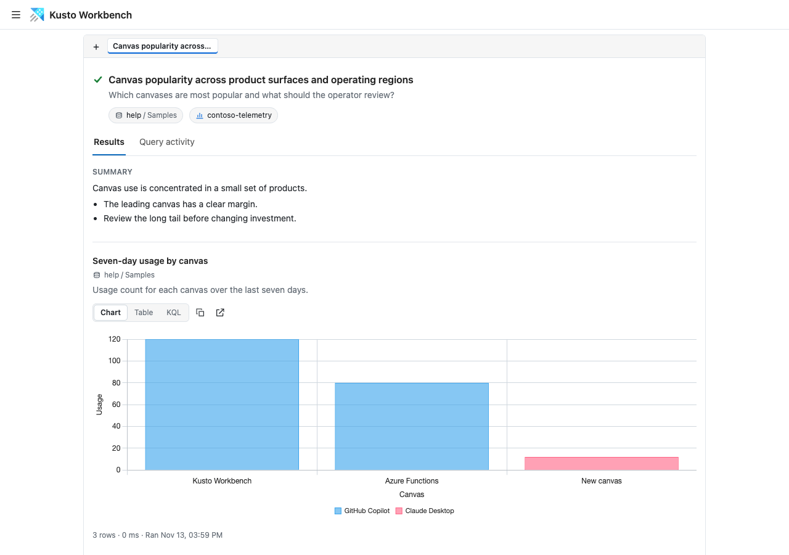

# Kusto Workbench

Ask Copilot telemetry questions across Azure Data Explorer and Log Analytics.
Kusto Workbench runs bounded read-only queries and keeps results, charts, and
query evidence together in the canvas.



## Install

In GitHub Copilot, open **Customize → Plugins** and install **Kusto Workbench**
from the **awesome-copilot** marketplace. If the marketplace is missing, add
it first:

```sh
copilot plugin marketplace add github/awesome-copilot
copilot plugin install kusto-workbench@awesome-copilot
```

Reopen Copilot and start a new chat. Requires Azure CLI signed in and read
access to the source you use.

## Try it

Ask in chat:

> Using Kusto Workbench, how did daily active users of `<table>` change over
> the last two weeks?

When prompted, choose your Azure CLI account and an Azure Data Explorer
database or Log Analytics workspace. Copilot runs bounded read-only queries.
Open **Investigations** to review the answer, charts, and supporting query
evidence.

To write or refine KQL yourself, open the optional **Query Editor**.

## What you can do

- **Investigations:** let Copilot run labeled read-only queries and organize
  transient findings and supporting evidence.
- **Results:** inspect up to 500 rows as a table or JSON, filter and sort them,
  configure a line or bar chart, and save CSV or JSON.
- **Data Sources:** discover authorized Azure Data Explorer clusters and Log
  Analytics workspaces, or enter a known target directly.
- **Query Editor:** draft and edit KQL with syntax highlighting, schema-aware
  suggestions, read-only checks, tabs, formatting, and selection-based runs.
- **Workbooks:** save query, target, and chart definitions to a session-visible
  file. Results, schema, credentials, and raw service errors stay transient.

Running a query, loading schema, and saving a workbook remain separate actions.
Kusto Workbench blocks user-authored management commands, remote entities,
external sources, plugins, callouts, and request-option overrides.

## Copilot CLI

The full plugin can be installed from Copilot CLI, but Kusto Workbench is a
visual canvas. Its panel and registered actions need a canvas-capable host; it
does not expose separate headless Kusto tools. See
[usage and CLI support](docs/advanced.md) for alternative installation,
version pinning, limits, and prerequisites.

## Usage data

Usage telemetry is enabled by default to help improve this plugin. It sends
basic usage data and, when available, your numeric GitHub user ID to the
[usage metrics service](https://canvas-metrics-pilot-0b8944-add3hsghhddcbxe9.b01.azurefd.net/api/events).
Prompts, tool inputs/outputs and credentials are excluded.

You can [disable usage telemetry](https://github.com/microsoft/azure-dev-tools#disable-usage-telemetry).
Copilot's own telemetry is separate.

## Prompts to try

> Using Kusto Workbench, how did daily active users of `<table>` change over
> the last two weeks?

> Investigate which services caused the recent error increase and show the
> supporting query evidence.

> In this Log Analytics workspace, chart failures by day and summarize the
> largest change.

> Open the Query Editor and help me refine this read-only KQL.
